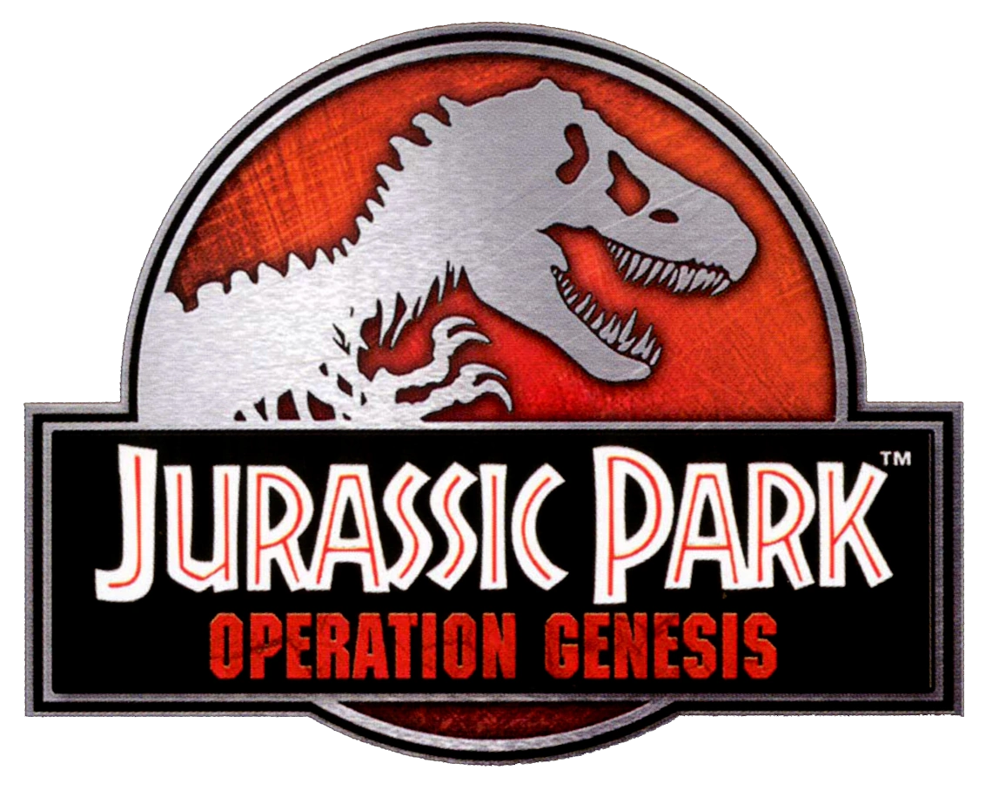
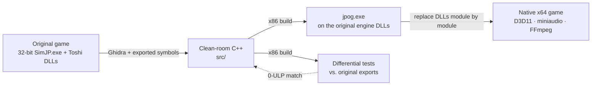

<div align="center">



# jpog-decomp

**A clean-room reimplementation of *Jurassic Park: Operation Genesis* (2003) as a native Windows x64 game**

<p>
<a href="https://github.com/Voikanaa/jpog-decomp/actions/workflows/ci.yml"></a>
<a href="docs/progress.md"><!-- coverage-badge:begin --><!-- coverage-badge:end --></a>
<a href="LICENSE"></a>

<br>


</p>

[Roadmap](docs/plan.md) · [Binary map](docs/modules.md) · [Progress](docs/progress.md) · [Issues](https://github.com/Voikanaa/jpog-decomp/issues) · [Milestones](https://github.com/Voikanaa/jpog-decomp/milestones) · [Contributing](CONTRIBUTING.md)

</div>

---

## About

*Jurassic Park: Operation Genesis* was built by Blue Tongue Software on their in-house **Toshi**
engine. It shipped as a 32-bit executable with Direct3D 8, FMOD 3, Bink video and SecuROM copy
protection, all of which are increasingly hard to run on modern systems.

This project rebuilds the game and engine from scratch in modern, portable C++. The goal is a
**native 64-bit Windows build** that plays the original game data unchanged.

- **Clean room:** every line comes from our own analysis of the shipped binaries and data.
- **Verified bit for bit:** each function is tested against the original DLL export on the same
  inputs, down to the last floating-point bit.
- **Bring your own game:** the repository contains no game code, assets or binaries.

## How it works



1. **Analyse.** Headless Ghidra decompiles every module. Over 23,000 exported C++ symbols give us
   the original class and method names, signatures and virtual method order.
2. **Reimplement.** Readable, portable C++20 that mirrors the original API (`Toshi::TMath`,
   `Toshi::TQuaternion`, `AUnitDinosaur`, …), with identical mangled names.
3. **Verify.** Differential tests load the original DLLs and compare every reimplemented function
   with its original export under the game's own FPU settings. Results must match exactly.
4. **Run.** Our `jpog.exe` already starts on the original engine DLLs. As modules are replaced,
   it depends on less of the original, until the same source builds as a standalone x64 game on
   Direct3D 11, Raw Input, miniaudio and FFmpeg.

## Status

| Milestone | Description | |
|---|---|:-:|
| Foundations | Symbols, build system, CI, analysis tooling | ✅ |
| **Launch 1** | Our `jpog.exe` opens the game window via the original engine DLLs | ✅ |
| **M2** | Toshi kernel reimplemented (`TMath`, `TVector2/3/4`, `TQuaternion` done) | 🚧 |
| **M3** | A mission loads through our renderer and resource code | ⏳ |
| **M4** | Full game playable on our code | ⏳ |
| **M5** | Native x64 build reaches the main menu | ⏳ |
| **M6** | Native x64 build plays a full mission with original saves | ⏳ |
| M1 | In-game A/B testing through a hook DLL (deferred: needs a runnable original) | ⏸️ |

Per-module coverage is in [docs/progress.md](docs/progress.md); the test suite currently runs
over 600,000 bit-exact differential checks.

## Getting started

### Requirements
| | |
|---|---|
| Compiler | Visual Studio 2022+ or Build Tools, with the *C++ x86/x64 build tools* (found automatically via `vswhere`) |
| Tools | Python 3.10+, Git, clang-format 20.1.8 (`pip install clang-format==20.1.8`, or put the exe in `toolchain/clang-format/`) |
| Analysis (optional) | Ghidra 12.1.4 in `toolchain/ghidra/` and JDK 21+ |
| Game | Your own copy of *Jurassic Park: Operation Genesis* (PC) |

### Setup
```bat
git clone git@github.com:Voikanaa/jpog-decomp.git
cd jpog-decomp
git config core.hooksPath .githooks       :: enable the pre-commit hygiene check

:: Put the installed game in JPOG\ (read-only reference) and a working copy in game\
python tools\dump_exports.py              :: regenerate symbols\ (optional; already committed)
python tools\setup_mcp.py                 :: optional: REA/Ghidra MCP config for Claude Code
```

### Build
```bat
tools\build.bat x86-debug    :: 32-bit jpog.exe on the original engine DLLs + all tests
tools\build.bat x64-debug    :: native x64 build + portable tests
```
The x86 build copies `jpog.exe` into `game\`, where it must be run. Differential tests find the
original DLLs in `JPOG\` (override with the `JPOG_ORIGINAL_DIR` environment variable) and are
skipped when the game is not present, as in CI.

## Repository layout

```
├── src/
│   ├── common/        shared headers (ABI macros, layout checks)
│   ├── toshi/         Toshi engine reimplementation, one folder per original DLL
│   ├── game/          jpog.exe: WinMain, application, crash handler
│   └── hook/          x86 hook DLL (deferred)
├── tests/
│   ├── kernel/        unit + differential tests per class
│   └── support/       original-DLL loader, float comparison, test helpers
├── cmake/             import libraries for the original engine DLLs
├── symbols/           export/import tables, classes and vtables of every original module
├── docs/              roadmap, binary map, progress log
├── tools/             analysis, build and maintenance scripts
└── third_party/       pinned, vendored dependencies
```

## Tools

| Script | Purpose |
|---|---|
| `tools/build.bat` | Configure, build and test a CMake preset (finds Visual Studio via `vswhere`) |
| `tools/ghidra_export.py` | Headless Ghidra decompilation of the original modules into `analysis/` (gitignored) |
| `tools/dump_vtables.py` | Recover the virtual method order of every exported class into `symbols/vtables.csv` |
| `tools/resolve_imports.py` | Annotate the game's decompilation with the names of the engine functions it calls |
| `tools/decomp_show.py` | Look up decompiled functions by name or address |
| `tools/dump_exports.py` | Regenerate `symbols/` from the original binaries |
| `tools/coverage.py` | Measure reimplementation coverage; regenerates [docs/progress.md](docs/progress.md) and the README badge |
| `tools/format.py` | Format all C++ with the pinned clang-format 20.1.8 (`--check` in CI and pre-commit) |
| `tools/make_import_lib.py` | Generate import libraries for the original engine DLLs from `symbols/` (used by CMake) |
| `tools/check_repo.py` | Hygiene check: no game files, nothing over 5 MB (CI + pre-commit) |
| `tools/msvc.py` | Locate the MSVC tools (`dumpbin`, `undname`, …) without hardcoded paths |
| `tools/setup_mcp.py` | Generate the machine-specific `.mcp.json` for the REA MCP server |

## Contributing

See [CONTRIBUTING.md](CONTRIBUTING.md) for the clean-room rules, workflow, commit conventions and
code style.

## License

The project's own code, tools and documentation are licensed under the
[GNU General Public License v3.0 or later](LICENSE). Vendored third-party code keeps its own
license (see [third_party/README.md](third_party/README.md)). The license does not cover the
game, its assets, or the *Jurassic Park* names and logo (`docs/jpog_logo.png`); see below.

## Legal

*Jurassic Park*, *Jurassic Park: Operation Genesis* and their logos are trademarks of Universal
City Studios and Amblin Entertainment. The game and the Toshi engine belong to their respective
rights holders. This is an unofficial, non-commercial fan project and is not affiliated with or
endorsed by them.

The repository contains no game code or assets: only original reimplementation code, tools and
documentation, plus symbol names extracted from the binaries for interoperability. To use it you
need your own legally obtained copy of the game.
