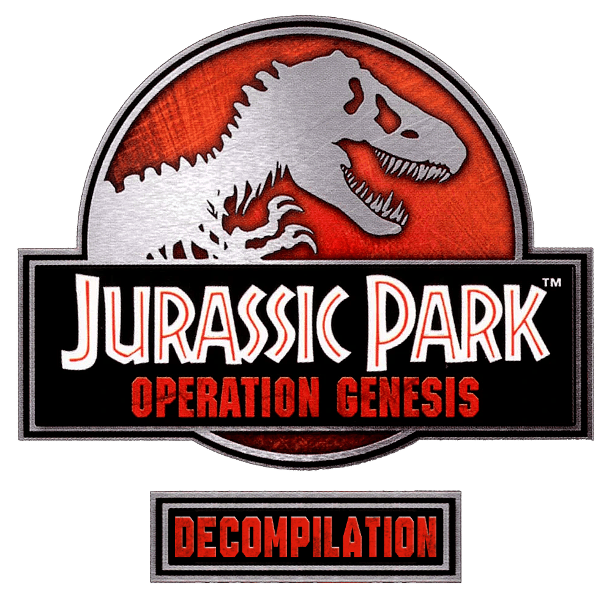
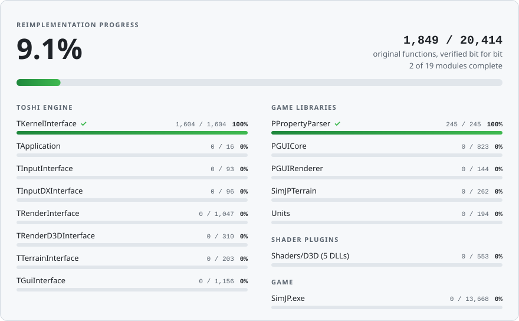
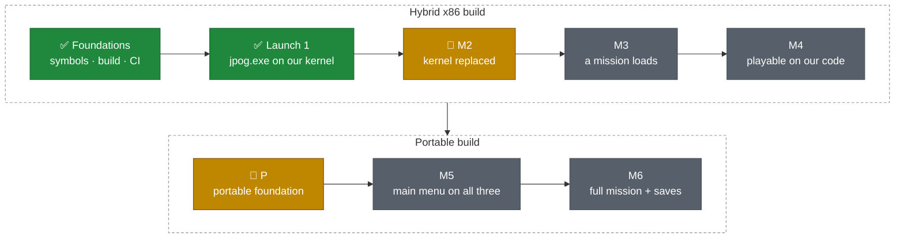

<div align="center">



### A native, cross-platform reimplementation of *Jurassic Park: Operation Genesis* (2003)

<p>
<a href="https://github.com/Voikanaa/jpog-decomp/actions/workflows/ci.yml"></a>
<a href="docs/progress.md"><!-- coverage-badge:begin --><!-- coverage-badge:end --></a>
<a href="LICENSE"></a>

<br>


</p>

[Roadmap](docs/plan.md) · [Progress](docs/progress.md) · [Binary map](docs/modules.md) · [File formats](docs/formats/README.md) · [Milestones](https://github.com/Voikanaa/jpog-decomp/milestones) · [Contributing](CONTRIBUTING.md) · [Credits](CREDITS.md)

</div>

---

*Jurassic Park: Operation Genesis* was built by Blue Tongue Entertainment on their in-house **Toshi**
engine and shipped as a 32-bit Windows game on Direct3D 8, FMOD 3, Bink video and SecuROM, a
stack that is increasingly hard to run today. **jpog-decomp** rebuilds the game and its engine in
modern, portable C++20, function by function, with the goal of a **native build for Windows,
Linux and macOS that plays the original game data unchanged.**

> [!IMPORTANT]
> This repository contains no game code, assets or binaries. You need your own legally obtained
> PC copy of the game.

## Highlights

- **Bit-exact by construction.** Every reimplemented function is checked against its original
  DLL export on the same inputs, down to the last floating-point bit. The suite runs over
  3 million differential assertions.
- **Original names and ABI.** More than 23,000 exported symbols give us the original class and
  method names, signatures and virtual method order. Our code exports the same mangled names, so
  it drops straight into the original game.
- **Running from day one.** Our own `jpog.exe` already starts the game on our Toshi kernel and
  `PPropertyParser.dll`, with the rest of the original engine DLLs still in place.
- **Built to outlive the original.** Portable code rules from the start (no 32-bit pointer
  assumptions, explicit file parsing, UTF-16 strings, case-insensitive paths) so the same source
  becomes a standalone game on SDL3, bgfx, miniaudio and FFmpeg.

## Progress

<a href="docs/progress.md">
  <picture>
    <source media="(prefers-color-scheme: dark)" srcset="docs/progress-dark.svg">
    
  </picture>
</a>

<sub>Generated from the x86 build by <code>tools/coverage.py</code>: a function counts once our code exports
it under the original mangled name and its differential tests pass.</sub>

### Roadmap



<details>
<summary><b>Milestone details</b></summary>

| | Milestone | Goal |
|:-:|---|---|
| ✅ | Foundations | Symbols, build system, CI, analysis tooling |
| ✅ | Launch 1 | Our `jpog.exe` opens the game window on our kernel and `PPropertyParser.dll` |
| 🚧 | **M2** | Kernel replaced: the game boots to the front end on our `TKernelInterface.dll` |
| 🚧 | **P** | Portable foundation: kernel and tests on Windows, Linux and macOS; SDL3 + bgfx shell (branch `portable-p1`) |
| ⏳ | M3 | A mission loads through our renderer and resource code |
| ⏳ | M4 | The full game is playable on our code |
| ⏳ | M5 | The portable build reaches the main menu on Windows, Linux and macOS |
| ⏳ | M6 | The portable build plays a full mission with original saves |
| ⏸️ | M1 | In-game A/B testing through a hook DLL (deferred: needs a runnable original) |

[Progress log](docs/progress.md) · [Roadmap](docs/plan.md) · [GitHub milestones](https://github.com/Voikanaa/jpog-decomp/milestones)

</details>

## Getting started

Today the build runs on Windows; Linux and macOS arrive with the portable foundation.

| Requirement | |
|---|---|
| Compiler | Visual Studio 2022+ or Build Tools with the C++ x86/x64 tools (found via `vswhere`) |
| Tools | Python 3.10+, Git, [uv](https://docs.astral.sh/uv/) (recommended) |
| Game | Your own PC copy of *Jurassic Park: Operation Genesis*, installed in `JPOG\` |
| Analysis (optional) | Ghidra 12.1.4 and JDK 21+ |

```bat
git clone https://github.com/Voikanaa/jpog-decomp.git
cd jpog-decomp
git config core.hooksPath .githooks   :: pre-commit checks
uv sync                               :: .venv with the pinned clang-format and ruff
:: without uv: python -m venv .venv && .venv\Scripts\pip install -r requirements-dev.txt

tools\build.bat x86-debug             :: 32-bit jpog.exe, our drop-in DLLs, all tests
tools\build.bat x64-debug             :: native x64 build and the portable tests
```

- Copy the installed game to `game\` as a working copy. The x86 build installs `jpog.exe`,
  `TKernelInterface.dll` and `PPropertyParser.dll` there, and the game runs from that folder.
  `"-DJPOG_REPLACE_KERNEL=OFF"` or `"-DJPOG_REPLACE_PPROPERTYPARSER=OFF"` restores an original DLL.
- Differential tests load the original DLLs from `JPOG\` (or `JPOG_ORIGINAL_DIR`) and are skipped
  without the game, as in CI.
- CI builds with `"-DJPOG_WERROR=ON"`; pass it locally to match.

## Repository layout

```
src/
  common/            ABI macros, layout checks
  toshi/kernel/      TKernelInterface.dll (math, containers, strings, file, memory, thread, time)
  toshi/…            declarations of the other engine DLLs (application, render, renderd3d, gui)
  ppropertyparser/   PPropertyParser.dll
  game/              jpog.exe: WinMain, application task tree, options, crash handler
tests/               doctest suite: unit and differential tests, original-DLL loader
symbols/             exports, imports, classes and vtables of every original module
docs/                roadmap, progress log, binary map, file-format catalogue
tools/               analysis, build and maintenance scripts
cmake/               import libraries for the original engine DLLs
third_party/         pinned, vendored dependencies
```

<details>
<summary><b>Tools</b></summary>

| Script | Purpose |
|---|---|
| `tools/build.bat` | Configure, build and test a CMake preset (`"-DOPTION=VALUE"` arguments allowed) |
| `tools/ghidra_export.py` | Headless Ghidra decompilation of the original modules into `analysis/` (gitignored) |
| `tools/decomp_show.py` | Look up decompiled functions by name or address |
| `tools/resolve_imports.py` | Name the engine calls in the game's decompilation |
| `tools/x87_expr.py` | Recover the exact floating-point evaluation order of an original function |
| `tools/dump_exports.py` | Regenerate `symbols/` from the original binaries |
| `tools/dump_vtables.py` | Recover the virtual method order of every exported class |
| `tools/coverage.py` | Measure coverage; regenerates [docs/progress.md](docs/progress.md), the badge and the progress card |
| `tools/make_import_lib.py` | Import libraries for the original engine DLLs (used by CMake) |
| `tools/make_module_def.py` | Export tables (`.def`) for our drop-in DLLs (used by CMake) |
| `tools/format.py` | Format all C++ with the pinned clang-format 20.1.8 |
| `tools/check_repo.py` | Hygiene check: no game files, nothing over 5 MB |
| `tools/msvc.py` | Locate the MSVC tools without hardcoded paths |
| `tools/setup_mcp.py` | Configure the REA/Ghidra MCP server for Claude Code |

</details>

## Documentation

| | |
|---|---|
| [Roadmap](docs/plan.md) | Goal, technical decisions, code rules, phases and verification strategy |
| [Progress](docs/progress.md) | Per-module coverage table and the development log |
| [Binary map](docs/modules.md) | The original modules, their exports and dependencies |
| [File formats](docs/formats/README.md) | Every file type in `Data/`: structure, status and sources |
| [Contributing](CONTRIBUTING.md) | Ground rules, workflow, commits and code style |
| [Credits](CREDITS.md) | The community research this project builds on |

## Credits

This project stands on more than twenty years of community research into *Operation Genesis* and
the Toshi engine. **We build on published facts, never on code:** every finding we use is cited,
re-verified against the original binaries and data, and credited in full in [CREDITS.md](CREDITS.md).

| | |
|---|---|
| **Decompilation** | [OpenJPOG](https://github.com/InfiniteC0re/OpenJPOG) and [OpenBarnyard](https://github.com/InfiniteC0re/OpenBarnyard) by InfiniteC0re · [OpenToshi](https://github.com/AdventureT/OpenToshi) by AdventureT |
| **File formats** | [The first JPOG format spec](https://www.trescom.org/hosted/andres_james/jpog/jpog_formats.html) by Andres James (2003) · [ojpog.io](https://github.com/OpenJPOG/org.equinoxscripts.ojpog.io) by equinox- · [jpog-blender](https://github.com/HENDRIX-ZT2/jpog-blender) and [convert-ppm](https://github.com/HENDRIX-ZT2/convert-ppm) by HENDRIX-ZT2 |
| **Modernisation** | [JPOG-Modernize](https://github.com/Newbie1337x/JPOG-Modernize) by Newbie1337x |
| **Community** | [Jurassic Mainframe](https://jurassicmainframe.forumotion.com/f17-jp-operation-genesis) · [Jurassic Mods](https://jurassicmods.darkbb.com) · [ModDB](https://www.moddb.com/games/jurassic-park-operation-genesis) · [Nexus Mods](https://www.nexusmods.com/jurassicparkopgen) · [JPOG Wiki](https://jpog.fandom.com) |
| **Original game** | Blue Tongue Entertainment, published by Universal Interactive (2003) |
| **Tools** | [Ghidra](https://github.com/NationalSecurityAgency/ghidra) · [doctest](https://github.com/doctest/doctest) · libraries of the portable build in [third_party/](third_party/README.md) |

<sub>Missing from the list, or got a detail wrong? Please [open an issue](https://github.com/Voikanaa/jpog-decomp/issues).</sub>

## License and legal

The project's own code, tools and documentation are licensed under the
[GNU General Public License v3.0 or later](LICENSE). Vendored libraries keep their own licenses
([third_party/README.md](third_party/README.md)).

*Jurassic Park*, *Jurassic Park: Operation Genesis* and their logos are trademarks of Universal
City Studios and Amblin Entertainment; the game and the Toshi engine belong to their respective
rights holders. This is an unofficial, non-commercial fan project, not affiliated with or
endorsed by them, and the license above does not cover the game, its assets, names or logos
(including `docs/jpog_decomp.png`). The repository contains only original code, tools and
documentation, plus symbol names extracted from the binaries for interoperability.

##

<div align="center">
<br>

<br>
<sub><i>Ah ah ah, you didn't say the magic word.</i></sub>
</div>
