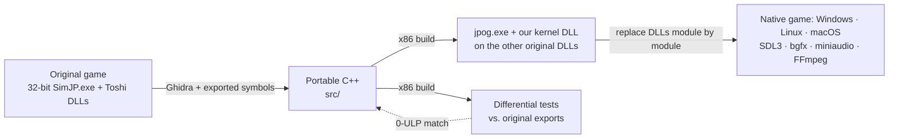

<div align="center">


**A reimplementation of *Jurassic Park: Operation Genesis* (2003) as a native cross-platform game**

<p>
<a href="https://github.com/Voikanaa/jpog-decomp/actions/workflows/ci.yml"></a>
<a href="docs/progress.md"><!-- coverage-badge:begin --><!-- coverage-badge:end --></a>
<a href="LICENSE"></a>

<br>


</p>

[Roadmap](docs/plan.md) · [Binary map](docs/modules.md) · [Progress](docs/progress.md) · [Issues](https://github.com/Voikanaa/jpog-decomp/issues) · [Milestones](https://github.com/Voikanaa/jpog-decomp/milestones) · [File formats](docs/formats/README.md) · [Contributing](CONTRIBUTING.md) · [Credits](CREDITS.md)

</div>

---

## About

*Jurassic Park: Operation Genesis* was built by Blue Tongue Software on their in-house **Toshi**
engine. It shipped as a 32-bit executable with Direct3D 8, FMOD 3, Bink video and SecuROM copy
protection, all of which are increasingly hard to run on modern systems.

This project rebuilds the game and engine from scratch in modern, portable C++. The goal is a
**native build for Windows, Linux and macOS** that plays the original game data unchanged.

- **Verified bit for bit:** each function is tested against the original DLL export on the same
  inputs, down to the last floating-point bit.
- **Bring your own game:** the repository contains no game code, assets or binaries.

## How it works



1. **Analyse.** Headless Ghidra decompiles every module. Over 23,000 exported C++ symbols give us
   the original class and method names, signatures and virtual method order.
2. **Reimplement.** Readable, portable C++20 that mirrors the original API (`Toshi::TMath`,
   `Toshi::TQuaternion`, `AUnitDinosaur`, …), with identical mangled names.
3. **Verify.** Differential tests load the original DLLs and compare every reimplemented function
   with its original export under the game's own FPU settings. Results must match exactly.
4. **Run.** Our `jpog.exe` already starts on our own Toshi kernel plus the remaining original
   engine DLLs. As modules are replaced, it depends on less of the original, until the same
   source builds as a standalone game for Windows, Linux and macOS on SDL3, bgfx, miniaudio and
   FFmpeg, with a Dear ImGui dev menu.

## Status

| Milestone | Description | |
|---|---|:-:|
| Foundations | Symbols, build system, CI, analysis tooling | ✅ |
| **Launch 1** | Our `jpog.exe` opens the game window via the engine DLLs, on our own kernel and `PPropertyParser.dll` | ✅ |
| **M2** | Toshi kernel replaced: every `TKernelInterface` export reimplemented and verified; the game boots on our DLL up to Launch 1 | 🚧 |
| **M3** | A mission loads through our renderer and resource code | ⏳ |
| **M4** | Full game playable on our code | ⏳ |
| **P** | Portable foundation: kernel and tests on Windows, Linux and macOS; SDL3 + bgfx shell | ⏳ |
| **M5** | Portable build reaches the main menu on Windows, Linux and macOS | ⏳ |
| **M6** | Portable build plays a full mission with original saves | ⏳ |
| M1 | In-game A/B testing through a hook DLL (deferred: needs a runnable original) | ⏸️ |

Per-module coverage is in [docs/progress.md](docs/progress.md); the test suite currently runs
almost 3 million differential checks, bit-exact for all float code.

## Getting started

### Requirements
| | |
|---|---|
| Compiler | Visual Studio 2022+ or Build Tools, with the *C++ x86/x64 build tools* (found automatically via `vswhere`) |
| Tools | Python 3.10+, Git, [uv](https://docs.astral.sh/uv/) (recommended), clang-format 20.1.8 and ruff 0.17.1 (installed into the project `.venv`, see Setup) |
| Analysis (optional) | Ghidra 12.1.4 (any location: `python tools/setup_mcp.py --ghidra <dir>`) and JDK 21+ |
| Game | Your own copy of *Jurassic Park: Operation Genesis* (PC) |

### Setup
```bat
git clone git@github.com:Voikanaa/jpog-decomp.git
cd jpog-decomp
git config core.hooksPath .githooks       :: enable the pre-commit hygiene check
uv sync                                   :: project .venv with pinned clang-format + ruff (uv.lock)
:: without uv: python -m venv .venv && .venv\Scripts\pip install -r requirements-dev.txt

:: Put the installed game in JPOG\ (read-only reference) and a working copy in game\
python tools\dump_exports.py              :: regenerate symbols\ (optional; already committed)
python tools\setup_mcp.py                 :: optional: REA/Ghidra MCP config for Claude Code
```

### Build
```bat
tools\build.bat x86-debug    :: 32-bit jpog.exe + our engine DLLs + all tests
tools\build.bat x64-debug    :: native x64 build + portable tests
```
The x86 build copies `jpog.exe` and our `TKernelInterface.dll` and `PPropertyParser.dll` into
`game\`, where the game must be run (`tools\build.bat x86-debug "-DJPOG_REPLACE_KERNEL=OFF"` or
`"-DJPOG_REPLACE_PPROPERTYPARSER=OFF"` puts the original DLL back).
CI builds every preset with `"-DJPOG_WERROR=ON"` (warnings as errors); pass it locally to match.
Differential tests find the original DLLs in `JPOG\` (override with the `JPOG_ORIGINAL_DIR`
environment variable) and are skipped when the game is not present, as in CI.

## Repository layout

```
├── src/
│   ├── common/        shared headers (ABI macros, layout checks)
│   ├── toshi/         Toshi engine, one folder per original DLL (kernel → TKernelInterface.dll;
│   │                  core classes at its root, then math/ containers/ strings/ file/ memory/ thread/ time/)
│   ├── ppropertyparser/  PPropertyParser.dll
│   ├── game/          jpog.exe: WinMain, application, crash handler
│   └── hook/          x86 hook DLL (deferred)
├── tests/
│   ├── kernel/        unit + differential tests per class, same subfolders as src/toshi/kernel
│   └── support/       original-DLL loader, float comparison, test helpers
├── cmake/             import libraries for the original engine DLLs
├── symbols/           export/import tables, classes and vtables of every original module
├── docs/              roadmap, binary map, progress log, file formats
├── tools/             analysis, build and maintenance scripts
└── third_party/       pinned, vendored dependencies
```

## Tools

| Script | Purpose |
|---|---|
| `tools/build.bat` | Configure, build and test a CMake preset, optionally with `"-DOPTION=VALUE"` arguments (finds Visual Studio via `vswhere`) |
| `tools/ghidra_export.py` | Headless Ghidra decompilation of the original modules into `analysis/` (gitignored) |
| `tools/dump_vtables.py` | Recover the virtual method order of every exported class into `symbols/vtables.csv` |
| `tools/resolve_imports.py` | Annotate the game's decompilation with the names of the engine functions it calls |
| `tools/x87_expr.py` | Recover the exact floating-point evaluation order of an original function from its x87 code |
| `tools/decomp_show.py` | Look up decompiled functions by name or address |
| `tools/dump_exports.py` | Regenerate `symbols/` from the original binaries |
| `tools/coverage.py` | Measure reimplementation coverage; regenerates [docs/progress.md](docs/progress.md) and the README badge |
| `tools/format.py` | Format all C++ with the pinned clang-format 20.1.8 (`--check` in CI and pre-commit) |
| `tools/make_import_lib.py` | Generate import libraries for the original engine DLLs from `symbols/` (used by CMake) |
| `tools/make_module_def.py` | Generate the export table (`.def`) of our drop-in DLLs from `symbols/` (used by CMake) |
| `tools/check_repo.py` | Hygiene check: no game files, nothing over 5 MB (CI + pre-commit) |
| `tools/msvc.py` | Locate the MSVC tools (`dumpbin`, `undname`, …) without hardcoded paths |
| `tools/setup_mcp.py` | Generate the machine-specific `.mcp.json` for the REA MCP server |

## Contributing

See [CONTRIBUTING.md](CONTRIBUTING.md) for the ground rules, workflow, commit conventions and
code style.

## Acknowledgements

This project builds on community research: Andres James' 2003 format notes, equinox-'s and
HENDRIX-ZT2's JPOG tools, the OpenJPOG / OpenBarnyard decompilations by InfiniteC0re and
AdventureT, and many modders. See [CREDITS.md](CREDITS.md) for the full list and how we use
their work.

## License

The project's own code, tools and documentation are licensed under the
[GNU General Public License v3.0 or later](LICENSE). Vendored third-party code keeps its own
license (see [third_party/README.md](third_party/README.md)). The license does not cover the
game, its assets, or the *Jurassic Park* names and logo (`docs/jpog_logo.png`); see below.

## Legal

*Jurassic Park*, *Jurassic Park: Operation Genesis* and their logos are trademarks of Universal
City Studios and Amblin Entertainment. The game and the Toshi engine belong to their respective
rights holders. This is an unofficial, non-commercial fan project and is not affiliated with or
endorsed by them.

The repository contains no game code or assets: only original reimplementation code, tools and
documentation, plus symbol names extracted from the binaries for interoperability. To use it you
need your own legally obtained copy of the game.

<div align="center">


</div>
